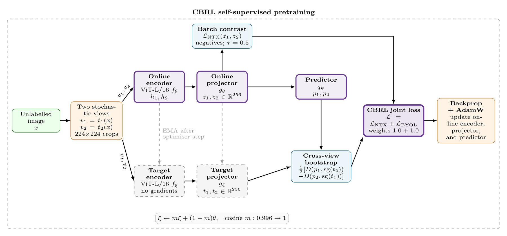
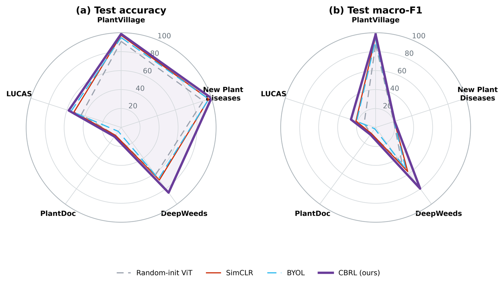

<div align="center">

# CBRL: Contrastive Bootstrap Representation Learning

**Label-efficient agricultural image classification with one self-supervised ViT**

[Hazem Ahmed](https://github.com/hazemahmed45) · Ali Hamdi · Ammar Mohammed

ICACIn'26 · Springer

[](https://arxiv.org/abs/2611.15610)
[](requirements.txt)
[](requirements.txt)
[](https://github.com/huggingface/pytorch-image-models)



</div>

## Overview

Collecting agricultural images is easy; getting experts to label them is not. **CBRL** pre-trains a
ViT-L/16 on the unlabelled images of the target dataset and then fine-tunes it on **only 10% of the
labels**. It optimises two self-supervised signals on one shared online projection space:

- **Batch contrast** (SimCLR-style NT-Xent, τ = 0.5) between the online projections of two views.
- **Cross-view bootstrap** (BYOL-style): an online predictor regresses the projections of an EMA
  target network, in both directions.

```
L = 1.0 · L_NT-Xent(z1, z2) + 1.0 · L_BYOL(p1, p2 | t1, t2)
```

The whole method is **two files**: `train.py` (pre-training + fine-tuning) and `prepare_data.py`
(datasets). Every setting lives in `config.yaml`.

## Results

Single-seed test results with **10% of the labels** and ViT-L/16, from the paper (macro-F1, %).
CBRL records the highest macro-F1 on all four primary benchmarks.

| Initialisation | PlantVillage | DeepWeeds | PlantDoc | LUCAS Cover Photos |
|:--|:--:|:--:|:--:|:--:|
| Random init | 87.71 | 47.49 | 8.06 | 12.78 |
| MAE | 93.61 | 50.67 | 1.10 | 20.94 |
| BYOL | 92.70 | 54.05 | 1.64 | 21.07 |
| SimCLR | 96.34 | 57.40 | 7.73 | 21.79 |
| Best of the other 9 | 97.71 *(Barlow Twins)* | 63.99 *(Denoising)* | 8.06 *(Random init)* | 21.79 *(SimCLR)* |
| **CBRL (ours)** | **98.14** | **79.77** | **9.31** | **27.31** |
| *CBRL accuracy* | *98.70* | *85.04* | *11.86* | *58.01* |

<p align="center"></p>

> [!NOTE]
> These are single-seed point estimates; they do not establish statistical superiority. PlantDoc is a
> negative result: no method reaches useful performance on it. The paper's CBRL runs predate this
> code. This repository implements the protocol of the follow-up three-seed ablation (1,024 images
> per step), so a rerun gives results of the same kind, not the paper's exact numbers.

## Getting started

### 1. Install

```bash
git clone git@github.com:hazemahmed45/CBRL.git && cd CBRL
python -m venv .venv && source .venv/bin/activate
pip install -r requirements.txt          # pinned versions used for the thesis runs
```

### 2. Prepare the data

```bash
python prepare_data.py deepweeds            # direct download
python prepare_data.py plantdoc             # direct download
python prepare_data.py plantvillage         # Kaggle CLI, or --source-dir <downloaded copy>
python prepare_data.py new_plant_diseases   # Kaggle CLI, or --source-dir <downloaded copy>
python prepare_data.py lucas_cover_photos   # 195,814 photos from the JRC FTP, resumable
```

<details>
<summary>What the script builds</summary>

Each command builds `data/<Name>/{train,val,test}/<class>/`, writes the 10% label splits for seeds
0, 1 and 2 to `data/splits/<dataset>/`, and compares both with checksums of the thesis data. It
prints `OK` per split when the data are identical. Datasets without a test split are split
70/15/15 per class with seed 0; LUCAS uses the level-1 land-cover code as the label and the exact
photo list in `manifests/lucas2018_images.txt.gz`.

| Dataset | Classes | Labelled training images (10%) |
|:--|--:|--:|
| PlantVillage | 38 | 3,803 |
| New Plant Diseases | 38 | 7,030 |
| DeepWeeds | 9 | 1,225 |
| PlantDoc | 28 | 235 |
| LUCAS Cover Photos | 59 | 13,669 |

</details>

### 3. Pre-train and fine-tune

```bash
python train.py all --dataset deepweeds --seed 0        # pre-train, then fine-tune and test
python train.py pretrain --dataset deepweeds --seed 0   # pre-training only
python train.py finetune --dataset deepweeds --seed 0   # fine-tune outputs/deepweeds/cbrl_seed0/pretrain_best.pt
```

Results land in `outputs/<dataset>/<run>/results.json` (test accuracy, macro-F1, weighted F1 and
balanced accuracy), next to `pretrain_{best,last}.pt`, `finetune_{best,last}.pt` and JSONL logs.
`--resume` continues an interrupted stage from its `*_last.pt`.

### 4. Ablations

Each term can be switched off to isolate its contribution:

```bash
python train.py all --dataset deepweeds --seed 0 --run-name contrastive_only_seed0 --bootstrap-loss-weight 0
python train.py all --dataset deepweeds --seed 0 --run-name bootstrap_only_seed0 --contrastive-loss-weight 0
```

## Training recipe

| | Pre-training | Fine-tuning |
|:--|:--|:--|
| Backbone | ViT-L/16, 224 × 224 | pre-trained encoder + dropout + linear head |
| Length | `round(N_train × 10,000 / 38,012)` steps (DeepWeeds 3,224 · PlantVillage 10,000 · LUCAS 35,948) | 50 epochs, 5 warm-up |
| Batch | 1,024 images | 64 (eval 128) |
| Optimiser | AdamW, lr 5e-4, wd 0.05, 5% warm-up + cosine | AdamW, encoder 1e-5 / head 1e-4, wd 0.05, cosine |
| Heads | projector 4096 → 256, predictor 4096, EMA 0.996 → 1 (cosine) | — |
| Augmentation | BYOL asymmetric views (Albumentations) | random resized crop, flip, colour jitter |
| Selection | lowest training loss (checked every 50 steps) | best validation macro-F1 → test once |

**Hardware.** A batch of 1,024 ViT-L/16 images fits on one 80 GB GPU with gradient checkpointing
(about 8 s per step). With less memory, lower `batch_size` and raise `gradient_accumulation` to
keep 1,024 images per step. This changes the BatchNorm batches and the NT-Xent negatives, so the
results are then close to, but not the same as, the thesis runs.

## Reproducibility

`train.py` is a single-file port of the thesis code (method `cbrl` of the `agri_ssl` package),
checked against it on CPU with the pinned packages:

- ✅ identical initial weights for the same seed
- ✅ identical losses for five optimisation steps, and identical weights afterwards (EMA target and
  BatchNorm statistics included)
- ✅ identical augmented views under the same Albumentations seed
- ✅ identical test metrics for a short fine-tuning run
- ✅ identical dataset splits and label splits (the checksums in `prepare_data.py`)

The pre-training augmentations draw their randomness from Albumentations, which seeds itself from
the operating system, as the thesis code did. Two runs with the same seed therefore differ by
ordinary run-to-run noise; report several seeds.

## Citation

If you find this work useful, please cite:

```bibtex
@inproceedings{ahmed2026cbrl,
  title     = {Contrastive Bootstrap Representation Learning for Label-Efficient Agricultural Image Classification},
  author    = {Ahmed, Hazem and Hamdi, Ali and Mohammed, Ammar},
  booktitle = {Proceedings of the 5th International Conference on Advanced Computing and Informatics (ICACIn'26)},
  address   = {Birmingham, UK},
  publisher = {Springer},
  year      = {2026},
  note      = {Also available as arXiv preprint arXiv:2611.15610}
}
```

## Acknowledgements

Built on [timm](https://github.com/huggingface/pytorch-image-models) and
[Albumentations](https://github.com/albumentations-team/albumentations). The objective combines
ideas from [SimCLR](https://arxiv.org/abs/2002.05709) and [BYOL](https://arxiv.org/abs/2006.07733).
